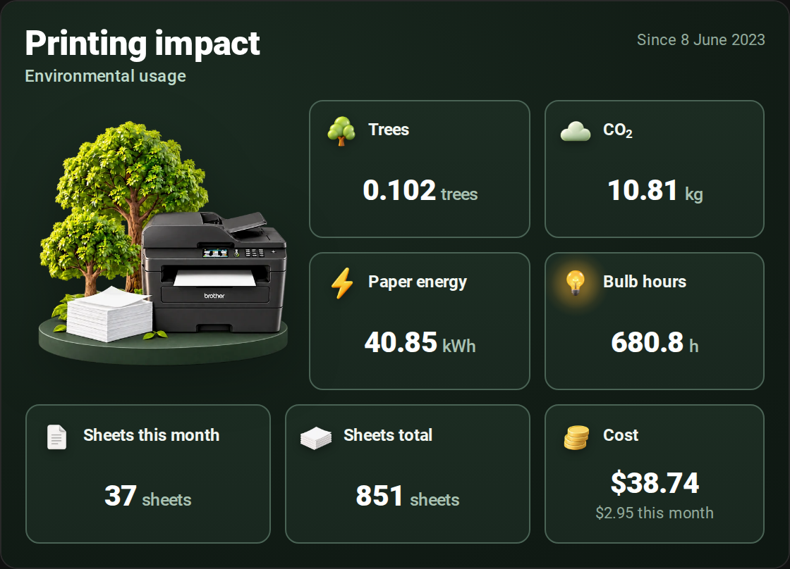
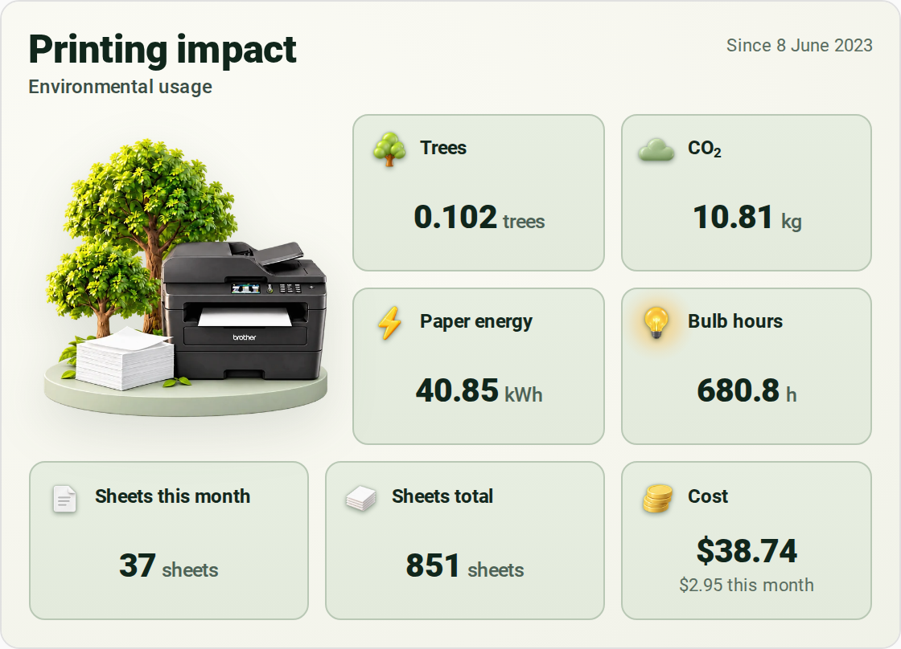
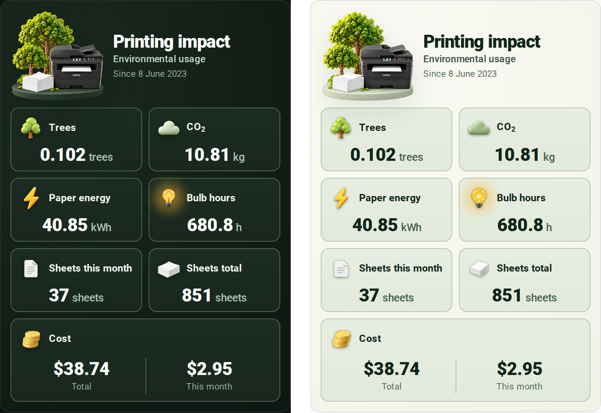
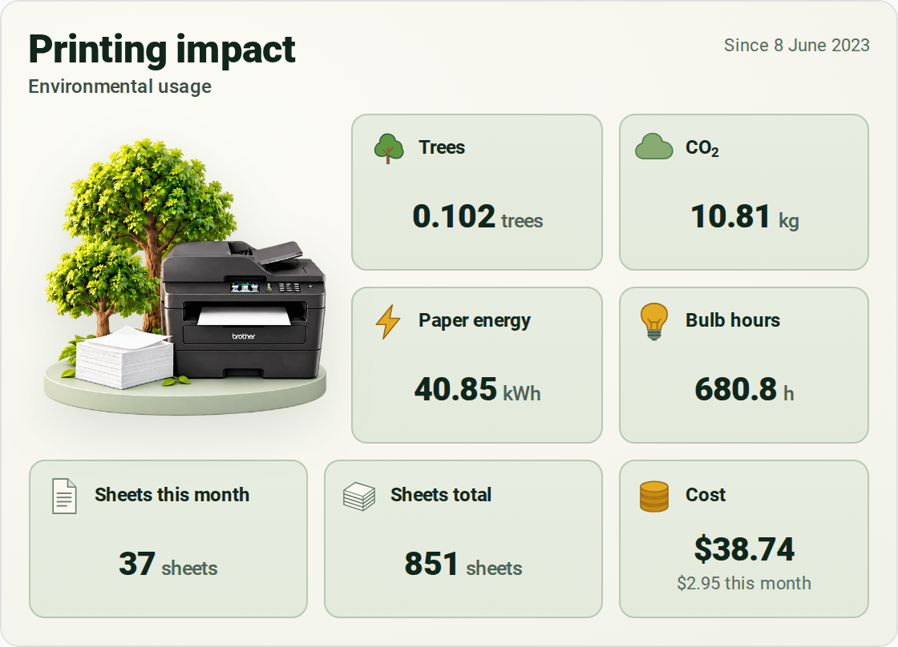
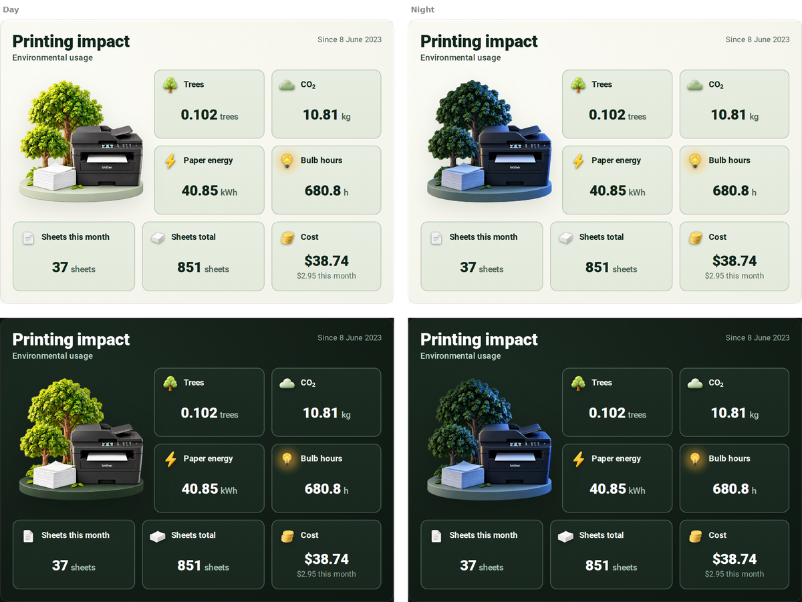
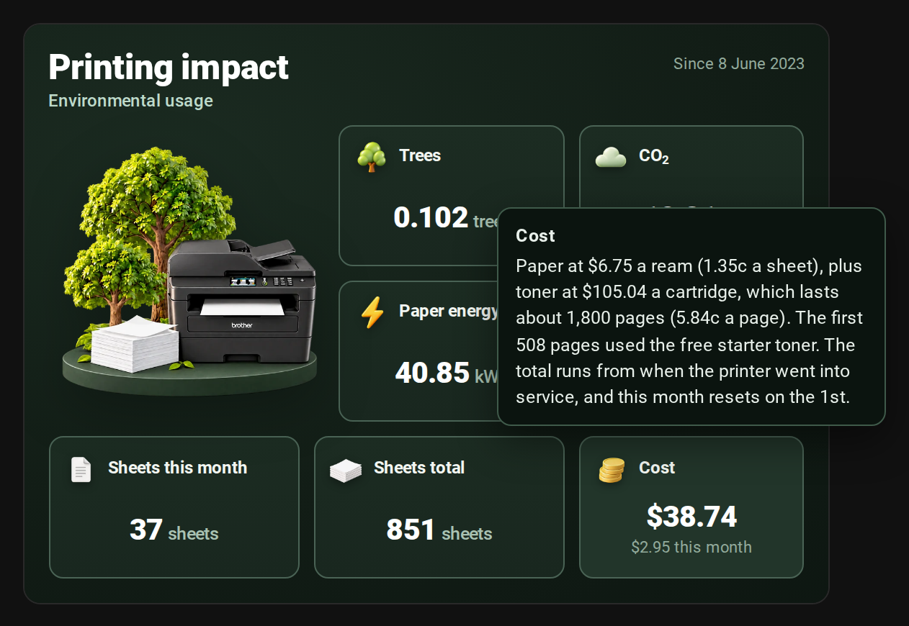

# Printing Environmental Impact Card for Home Assistant

A Home Assistant card that shows what your printing costs the planet and your wallet: the trees, CO₂
and energy behind the paper you've used, the sheets themselves, and what it has all cost in paper and
toner. It's modelled on the Printing Impact widget in PaperCut, the print management software used by
schools and offices, and uses the same factors.

It was built around my **Brother MFC-L2730DW**. The artwork is that printer, and the ready-made
sensors read the Brother integration's page counters. Both are easy to swap: put your own printer in
the picture, and feed the card from whatever integration your printer uses.

## What it looks like





The card follows your Home Assistant theme, switching between its light and dark artwork as the theme
does.

### On a phone, or in one dashboard column

Narrower than about 460 px, the card rearranges itself: the illustration moves up beside the title,
the figures go two to a row, and Cost runs across the bottom with the total and this month side by
side.



### Flat icons

There's a flat icon set too, switched on with one toggle in the card's settings.




### Day and night

Turn on **Night scene after sunset** and the printer's picture follows the sun: the usual scene
while it's up, a moonlit version once it sets. Nothing else on the card changes. It uses Home
Assistant's built-in sun integration, so it follows your location and the seasons with no set-up.

Turn on **Dark look after sunset** as well and the whole card switches to its dark version at night,
even if your Home Assistant theme is light.



### What each figure means

Hover over any figure for a short explanation of how it's worked out. On a phone, long-press instead;
a normal tap still opens the history.



## What it shows

| Figure | What it is |
|---|---|
| **Trees** | The trees that went into making the paper you've printed on, at 8,333 sheets of A4 per tree. |
| **CO₂** | Greenhouse gases released in producing that paper, as CO₂ equivalent: 12.7 g per sheet. |
| **Paper energy** | The energy used to produce the paper, 48 Wh per sheet. This is the paper's footprint, not the printer's own power use. |
| **Bulb hours** | The paper energy as hours of a standard 60 W light bulb. |
| **Sheets this month** | Sheets of paper used since the 1st of the month. |
| **Sheets total** | Sheets of paper used since the printer went into service. |
| **Cost** | Paper plus toner, in total and for this month, from prices you enter. |
| **Since** | The date the printer went into service (top right). |

A sheet printed on both sides counts as one sheet: the figures are about paper, not printed pages.

The tree, CO₂ and energy factors are PaperCut's defaults, described in
[PaperCut's environmental impact documentation](https://papercut.com/help/manuals/ng-mf/common/sys-environmental-impact).
They cover making the paper only, not running the printer or the toner.

### How the cost is worked out

* **Paper:** the price of a 500-sheet ream, divided by 500, for every sheet used.
* **Toner:** the price of a cartridge divided by the pages it really lasts, for every printed page
  (each side of a double-sided sheet is a page).
* **The starter cartridge** that came in the box cost nothing, so the pages printed on it count as
  free. Its paper still counts.

Rated toner yields assume 5% page coverage, and most people print more than that. For a truer figure,
divide the pages printed on your current cartridge by the fraction of toner it has used. My cartridge
had used 26% of its toner over 467 pages, so it will last about 1,800 pages, not the 3,000 on the box.

## What you need

* Home Assistant (developed and tested on 2026.10).
* A printer that reports how many pages it has printed. The included package uses
  [Home Assistant's Brother integration](https://www.home-assistant.io/integrations/brother/), which
  works with most networked Brother printers. Other printers are covered under
  [Other printers](#other-printers).

## Installation

### 1. Add the sensors

[`packages/printing_impact.yaml`](packages/printing_impact.yaml) creates everything the card reads: the
sheet count, the environmental figures, the cost, the weekly and monthly counters, and helpers for
your prices and the in-service date.

1. Open the file and replace every `mfc_l2730dw` with your printer's entity prefix. You'll find it
   under **Settings > Devices & services > Brother**: if your page counter is
   `sensor.hl_l2350dw_page_counter`, the prefix is `hl_l2350dw`.
2. Save it as `config/packages/printing_impact.yaml`. If you don't use packages yet, add this to
   `configuration.yaml`:

   ```yaml
   homeassistant:
     packages: !include_dir_named packages
   ```

3. Check the configuration under **Developer tools > YAML**, then restart.
4. Under **Settings > Devices & services > Helpers**, set:

   | Helper | What to enter |
   |---|---|
   | Printer paper price per ream | What you pay for 500 sheets |
   | Printer toner price | What you pay for a cartridge |
   | Printer toner yield | Pages a cartridge really lasts (see above) |
   | Printer starter toner pages | Pages printed on the free starter cartridge, or 0 |
   | Printer in service since | When you started using the printer |

The cost sensors are in Australian dollars. Change `AUD` in the package to your currency's code.

### 2. Install the card

**With HACS**

1. In HACS, open the menu (⋮) and choose **Custom repositories**.
2. Add `https://github.com/CameronSmith93/printing-environmental-impact-card-HA` with the type
   **Dashboard**.
3. Find **Printing Environmental Impact Card**, download it, and refresh your browser.

**By hand**

1. Copy [`dist/printing-impact-card.js`](dist/printing-impact-card.js) to `config/www/`.
2. Under **Settings > Dashboards**, open the menu (⋮), choose **Resources**, and add
   `/local/printing-impact-card.js` as a **JavaScript module**.
3. Refresh your browser.

The card is a single file with all its artwork built in, so there's nothing else to copy.

### 3. Add the card to a dashboard

Search for **Printing** in the card picker, or add it in YAML:

```yaml
type: custom:printing-impact-card
```

If you used the package, that's all it needs. Everything else can be set in the card's visual editor.

## Configuration

| Option | Default | What it does |
|---|---|---|
| `flat_icons` | `false` | Use the flat icon set instead of the 3D icons. |
| `tooltips` | `true` | Explain each figure on hover, or on long-press on a phone. |
| `day_night` | `false` | Show the night-time picture while the sun is down. |
| `dark_at_night` | `false` | Use the card's dark look while the sun is down, even with a light theme. |
| `sun` | `sun.sun` | The sun entity that decides when it's night. |
| `title` | `Printing impact` | The card's title. |
| `subtitle` | `Environmental usage` | The line under the title. |
| `trees` | `sensor.printer_trees_used` | Trees used. |
| `co2` | `sensor.printer_co2_emissions` | CO₂, in kg. |
| `paper_energy` | `sensor.printer_paper_energy` | Paper energy, in kWh. |
| `bulb_hours` | `sensor.printer_lightbulb_hours` | Bulb hours. |
| `sheets_month` | `sensor.printer_sheets_this_month` | Sheets this month. Shows 0 until the first print of the month. |
| `sheets_total` | `sensor.printer_sheets_used` | Sheets in total. |
| `cost` | `sensor.printer_cost_total` | Total cost. |
| `cost_month` | `sensor.printer_cost_this_month` | This month's cost. |
| `since` | `input_datetime.printer_in_service_since` | The in-service date. |
| `paper_price` | `input_number.printer_paper_price_per_ream` | Used in the Cost description. |
| `toner_price` | `input_number.printer_toner_price` | Used in the Cost description. |
| `toner_yield` | `input_number.printer_toner_yield` | Used in the Cost description. |
| `starter_pages` | `input_number.printer_starter_toner_pages` | Used in the Cost description. |
| `illustration` | built-in | Your own printer picture (see below). |
| `illustration_dark` | `illustration` | A separate picture for dark mode. |
| `illustration_night` | built-in | Your own night-time picture, for `day_night`. |
| `asset_base` | built-in | A folder with `dark/`, `light/` and `night/` sub-folders of replacement artwork, using the file names in [`assets/`](assets). |
| `descriptions` | built-in | Your own hover text, keyed by figure: `trees`, `co2`, `paper_energy`, `bulb_hours`, `sheets_month`, `sheets_total`, `cost`, `since`. |

A fuller example:

```yaml
type: custom:printing-impact-card
flat_icons: false
title: Study printer
subtitle: Environmental usage
illustration: /local/printing-impact/my-printer-light.png
illustration_dark: /local/printing-impact/my-printer-dark.png
day_night: true
dark_at_night: true
illustration_night: /local/printing-impact/my-printer-night.png
descriptions:
  bulb_hours: The paper energy as hours of a 10 W LED bulb.
```

## Using your own printer's picture

The printer in the illustration is my MFC-L2730DW. To show yours:

1. **Get a picture of your printer.** On a Mac, the easiest source is the icon macOS downloads from
   the printer when you add it with AirPrint. It's kept in `/Library/Printers/Icons` (in Finder, choose
   **Go > Go to Folder…** and paste the path). Convert it to a PNG with:

   ```sh
   sips -s format png "/Library/Printers/Icons/<the icon>.icns" --out my-printer.png
   ```

2. **Make the illustration.** Give an image generator your printer picture, plus
   [`assets/light/illustration.png`](assets/light/illustration.png) and
   [`assets/dark/illustration.png`](assets/dark/illustration.png) as style references. Ask for the same
   scene (your printer on a round plinth, with two trees behind and a stack of paper beside it) as a
   square PNG with a transparent background, about 1,000 px across. Make one with the pale sage plinth
   for light mode and one with the dark green plinth for dark mode. For `day_night`, add a third: the
   same scene at night, lit by moonlight, like [`assets/night/illustration.png`](assets/night/illustration.png).
3. **Add it to Home Assistant.** Copy the two files into `config/www/printing-impact/`, then set
   `illustration` and `illustration_dark` (and `illustration_night`) to
   `/local/printing-impact/<file name>`.

## Other printers

The card only needs sensors, so it works with any printer whose page count reaches Home Assistant.
Every entity can be changed in the card's settings.

In the package, only two sensors come from the printer:

* **`sensor.mfc_l2730dw_page_counter`:** total pages (sides) printed. Required.
* **`sensor.mfc_l2730dw_duplex_unit_page_counter`:** pages printed double-sided. Optional: without it,
  every page counts as a sheet. Set its line in the package to ``.

Replace them with your own printer's sensors and everything else follows. If your printer's
integration doesn't give a page count, most networked printers report one over SNMP through the
standard Printer MIB. Home Assistant's [SNMP integration](https://www.home-assistant.io/integrations/snmp/)
can read it:

```yaml
sensor:
  - platform: snmp
    name: Printer page counter
    host: 192.168.1.50 # your printer's address
    baseoid: 1.3.6.1.2.1.43.10.2.1.4.1.1 # prtMarkerLifeCount: total pages printed
    unit_of_measurement: pages
    scan_interval: 300
```

That gives you `sensor.printer_page_counter` to use in place of the Brother one.

## Building from source

The card's source is [`src/printing-impact-card.js`](src/printing-impact-card.js). The 3D icons and
illustrations in [`assets/`](assets), including the night scene, are built into
[`dist/printing-impact-card.js`](dist/printing-impact-card.js) by [`build.py`](build.py):

```sh
pip install pillow
python3 build.py
```

The flat icons are drawn in SVG inside the source. Copies are in [`assets/flat`](assets/flat).

## Credits

* The figures and their factors follow PaperCut's Printing Impact widget and its
  [environmental impact defaults](https://papercut.com/help/manuals/ng-mf/common/sys-environmental-impact).
* The illustration and icons were made for this project with an AI image generator, starting from the
  icon macOS downloaded for my printer.

This project isn't affiliated with or endorsed by Brother Industries or PaperCut Software. Brother is a
trademark of Brother Industries, Ltd., and PaperCut is a trademark of PaperCut Software Pty Ltd.

## Licence

[MIT](LICENSE)
